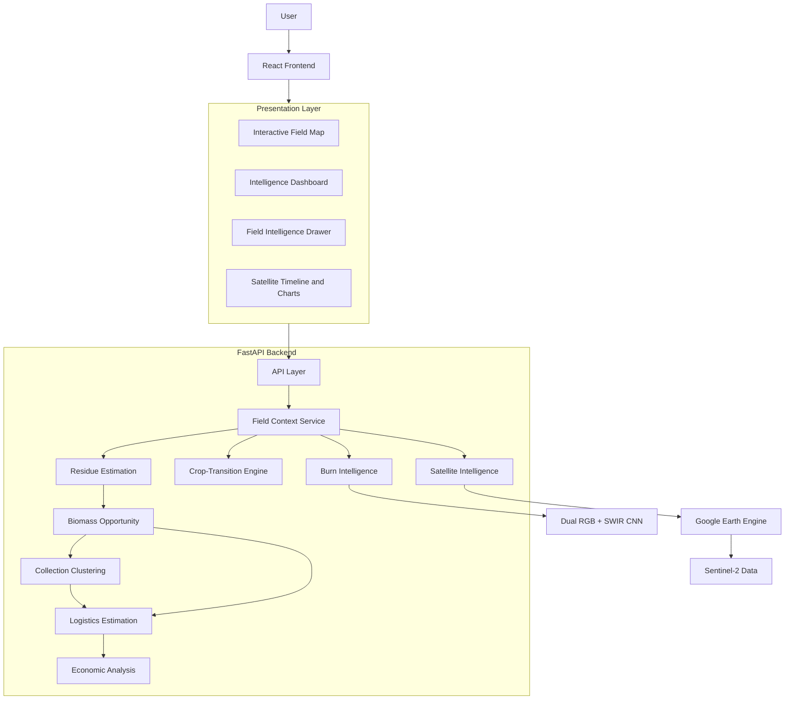
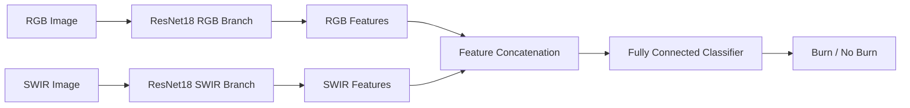

# 🌾 Project Parali

### Satellite AI for Crop-Residue Detection, Crop-Transition Intelligence & Biomass Recovery

**Transforming satellite observations into actionable agricultural intelligence.**

Project Parali is an AI-powered geospatial intelligence platform designed to connect satellite-based crop monitoring with agricultural residue recovery and biomass logistics. By combining Sentinel-2 satellite imagery, Google Earth Engine, machine learning, geospatial analytics, and economic estimation, the platform helps identify crop-transition signals, assess burn-related evidence, estimate recoverable biomass, discover nearby biomass facilities, and evaluate potential collection opportunities.

**Satellite Intelligence → Field Intelligence → Biomass Intelligence → Operational Planning**

---

## 🚀 Project Overview

Agricultural residue management is not only an environmental challenge but also a problem of timing, visibility, resource recovery, and logistics.

Project Parali aims to bridge the gap between satellite observations and real-world biomass operations through a unified, field-centric intelligence platform.

### Key Objectives

- Monitor agricultural fields using satellite observations.
- Identify potential crop-transition and harvest-window signals.
- Analyze burn-related spectral patterns and independent ML evidence.
- Estimate agricultural residue and recoverable biomass.
- Match potential biomass supply with nearby processing facilities.
- Group nearby fields into collection clusters.
- Estimate transportation distance and logistics costs.
- Calculate estimated revenue and net profit under configurable assumptions.
- Present field-level insights through an interactive geospatial dashboard.

---

## ✨ Core Features

| Feature | Description |
|---|---|
| 🛰️ Satellite Intelligence | Processes Sentinel-2 observations using Google Earth Engine. |
| 🌱 Crop-Transition Analysis | Evaluates vegetation trends to identify candidate transition windows. |
| 🔥 Burn Intelligence | Combines transparent spectral analysis with independent CNN evidence. |
| 🌾 Biomass Estimation | Estimates gross residue and recoverable biomass. |
| 🏭 Facility Matching | Identifies potential biomass facilities within a configured search radius. |
| 🗺️ Interactive Field Mapping | Displays field boundaries and supports field-level exploration. |
| 🔗 Field Context Resolution | Preserves logical field identities, source records, geometry, and metadata. |
| 📍 Collection Clustering | Groups nearby fields to support collection planning. |
| 🚚 Logistics Estimation | Estimates road distance and transportation costs. |
| 💰 Economic Analysis | Estimates biomass revenue, transport expenses, and net profit. |
| 📊 Intelligence Dashboard | Presents field conditions, satellite timelines, and operational insights. |
| 🤖 Deep Learning | Uses a Dual RGB + SWIR ResNet18 model for image-based burn classification. |

---

## 🛠️ Technology Stack

### Frontend
- React.js
- Vite
- Leaflet / React-Leaflet
- Recharts
- CSS

### Backend
- Python
- FastAPI
- REST APIs

### Satellite & Geospatial Processing
- Google Earth Engine
- Sentinel-2 Surface Reflectance Harmonized
- GeoJSON
- NDVI, NBR, NBR2, and SWIR-derived indicators

### Machine Learning
- PyTorch
- ResNet18
- Dual RGB + SWIR architecture
- Random Forest
- Support Vector Machine (SVM)
- Scikit-learn

### Data & Infrastructure
- CSV-based processed datasets
- Geospatial field records
- Git and Git LFS for version control and large model artifacts

---

## 🏗️ System Architecture

The platform follows a modular architecture in which the frontend communicates with a FastAPI backend. The backend coordinates field-context resolution, satellite processing, crop-transition analysis, burn intelligence, biomass estimation, facility matching, clustering, logistics, and economic calculations.



---

## 🛰️ Satellite Intelligence

Project Parali uses Sentinel-2 Surface Reflectance Harmonized observations to derive field-level spectral indicators.

| Indicator | Purpose |
|---|---|
| NDVI | Evaluates vegetation greenness and changes over time. |
| NBR | Supports analysis of vegetation and burn-related spectral changes. |
| NBR2 | Provides additional SWIR-based spectral information. |
| SWIR/NIR | Supports assessment of changes in vegetation and surface conditions. |

The satellite-processing pipeline includes:

1. Resolving the selected field geometry.
2. Retrieving relevant Sentinel-2 observations.
3. Filtering and masking cloud-affected pixels.
4. Scaling reflectance values.
5. Computing spectral indicators.
6. Aggregating measurements at field level.
7. Building a date-based time series.
8. Sharing observations with downstream intelligence modules.

---

## 🤖 Machine Learning and Burn Intelligence

The project includes a Dual RGB + SWIR ResNet18 model for image-based burn classification.

The architecture processes RGB and SWIR representations through separate feature-extraction branches, combines the resulting features, and produces a two-class output.



### Separate Evidence Streams

The live burn-intelligence workflow distinguishes between:

- **Spectral evidence:** Field-level signals derived from Sentinel-2 observations.
- **ML evidence:** Output from the existing image-trained Dual RGB + SWIR model when its live inference bridge is available.

These outputs are intentionally kept separate because the existing CNN was trained on a separate image dataset rather than directly on the project's Sentinel-2 field patches.

### Model Evaluation

The original project baseline reports the following benchmark results:

| Model | Reported Accuracy |
|---|---:|
| Random Forest | Approximately 87.00% |
| SVM | 88.01% |
| RGB ResNet18 | 81.27% |
| Dual RGB + SWIR CNN | 91.76% |
| Harvest-Stage Random Forest | 82.77% |

The reported Dual CNN F1 score is **93.45%**.

These metrics describe evaluation on the corresponding image dataset. They should not be interpreted as validated accuracy on live Sentinel-2 field observations.

---

## 🌾 Biomass Recovery and Opportunity Analysis

The biomass engine estimates potentially recoverable agricultural residue using field area and configurable agricultural assumptions.

Conceptually:

```text
Field Area
    ×
Crop Yield Assumption
    ×
Residue-to-Product Ratio
    =
Estimated Gross Residue
    ×
Collection Efficiency
    =
Estimated Recoverable Biomass
```

The opportunity engine connects estimated biomass availability with potential nearby facilities.

The platform also supports spatial grouping of nearby fields to help organize collection opportunities and estimate aggregated biomass quantities.

---

## 🚚 Logistics and Economic Analysis

Project Parali estimates transportation requirements and potential economic outcomes using configurable assumptions.

### Estimated Road Distance

```text
Straight-Line Distance × Road Factor
    =
Estimated Road Distance
```

### Estimated Transportation Cost

```text
Recoverable Biomass
    ×
Estimated Road Distance
    ×
Transport Rate
    =
Estimated Transport Cost
```

### Estimated Net Profit

```text
Gross Biomass Revenue
    -
Estimated Transport Cost
    =
Estimated Net Profit
```

The current economic calculation does not automatically include harvesting, baling, loading, labour, taxes, facility fees, or other operating expenses. Therefore, the result should be interpreted as an **estimated opportunity**, not realized business profit.

---

## 📂 Project Structure

The main application is organized into frontend, backend, data, and model components.

```text
Project-Parali/
├── backend/
│   ├── api.py
│   ├── field_context.py
│   ├── satellite_service.py
│   ├── harvest_prediction.py
│   ├── live_burn_analysis.py
│   ├── residue_estimation.py
│   ├── biomass_opportunity.py
│   ├── biomass_clustering.py
│   ├── logistics_estimation.py
│   ├── predict.py
│   ├── models/
│   └── requirements.txt
│
├── data/
│   ├── sangrur/
│   └── processed/
│
├── frontend/
│   ├── src/
│   │   ├── App.jsx
│   │   ├── FieldMap.jsx
│   │   └── components/
│   ├── package.json
│   └── ...
│
├── .env.example
├── .gitignore
└── README.md
```

*This is a representative structure; refer to the actual repository for the complete file layout.*

---

## ⚙️ Installation and Local Setup

### Prerequisites

Install the following before running the project:

- Python 3.11 or later
- Node.js and npm
- Git
- Git LFS, where required for large model files
- An appropriately configured Google Earth Engine account and project

### 1. Clone the Repository

```bash
git clone https://github.com/YOUR_USERNAME/Project-Parali.git
cd Project-Parali
```

Replace the repository URL with the actual project URL.

### 2. Configure the Backend

```powershell
cd backend
python -m venv venv
.\venv\Scripts\Activate.ps1
pip install -r requirements.txt
```

Start the FastAPI server:

```bash
uvicorn api:app --reload
```

The backend will typically be available at:

```text
http://127.0.0.1:8000
```

Interactive API documentation:

```text
http://127.0.0.1:8000/docs
```

### 3. Configure the Frontend

Open a separate terminal:

```bash
cd frontend
npm install
npm run dev
```

The Vite development server will typically be available at:

```text
http://localhost:5173
```

Configure the frontend API URL using the environment variable:

```env
VITE_API_URL=http://127.0.0.1:8000
```

Use the appropriate deployed API URL in production.

### 4. Configure Google Earth Engine

Before using live satellite functionality:

1. Configure an eligible Google Earth Engine project.
2. Authenticate using the project's supported authentication workflow.
3. Ensure the backend can access the required Sentinel-2 collection.
4. Verify that satellite queries work for the available field geometries.

Never commit private credentials or service-account keys.

---

## 📡 API Reference

The backend exposes domain-specific endpoints through FastAPI.

| Method | Endpoint | Purpose |
|---|---|---|
| GET | `/` | Basic API information |
| GET | `/health` | Backend health check |
| GET | `/model-info` | Loaded model metadata |
| GET | `/fields` | Field dataset used by the frontend |
| GET | `/field-analysis/{field_id}` | Combined field intelligence |
| GET | `/live-harvest-prediction/{field_id}` | Crop-transition assessment |
| GET | `/live-burn-analysis/{field_id}` | Live burn intelligence |
| GET | `/residue-estimation/{field_id}` | Residue and biomass estimation |
| GET | `/biomass-opportunity/{field_id}` | Potential nearby facility opportunities |
| GET | `/biomass-cluster/{field_id}` | Collection-cluster information |
| GET | `/biomass-clusters` | Available biomass clusters |
| GET | `/logistics-estimation/{field_id}` | Distance and transport-cost estimates |
| POST | `/predict` | Manual image-based ML inference |

Consult the running API documentation for the actual request schemas, response fields, and validation requirements.

---

## 🧪 Testing and Validation

The project should be validated at multiple levels.

### Backend Validation
- Confirm the API starts successfully.
- Verify the health endpoint.
- Check that model metadata is returned correctly.

### Field Data Validation
- Confirm that `/fields` returns valid field data.
- Verify logical-field and source-field relationships.
- Check that geometry, area, and metadata are consistent.

### Intelligence Service Validation
- Test crop-transition analysis.
- Test live burn analysis.
- Test biomass estimation and facility matching.
- Test clustering and logistics calculations.
- Verify that optional CNN failures do not prevent spectral results from being returned.

### End-to-End Validation
- Load the frontend dashboard.
- Render the interactive map.
- Select a field.
- Verify satellite observations and field context.
- Confirm that biomass, logistics, and economic information appear when the required inputs are available.

---

## 🔐 Security and Configuration

Before deployment:

- Keep API keys and private credentials out of source control.
- Use `.env.example` to document required environment variables without including real secrets.
- Configure production CORS rules.
- Store deployment-specific values in environment configuration.
- Validate incoming API requests.
- Handle satellite-service failures gracefully.
- Use Git LFS or appropriate model storage for large model artifacts.
- Review repository contents before publishing.

---

## ⚠️ Limitations

Project Parali provides decision-support estimates rather than guaranteed ground truth.

- Crop-transition signals do not independently confirm actual harvest dates.
- Burn-related spectral changes require contextual interpretation.
- Existing CNN benchmark metrics do not establish Sentinel-2 field-level model accuracy.
- Biomass quantities depend on configurable agricultural assumptions.
- Straight-line distance multiplied by a road factor is an approximation, not live route calculation.
- Economic estimates depend on sale price, transport rate, road factor, and biomass assumptions.
- The current net-profit estimate excludes several operating expenses.

These limitations should be considered when interpreting results or using the platform for operational decisions.

---

## 🛣️ Future Improvements

Potential areas for further development include:

- Training and validating a native Sentinel-2 burn-detection model.
- Incorporating field-level harvest-date ground truth.
- Improving biomass estimates with region-specific crop and residue data.
- Integrating road-network routing and more accurate travel-cost estimates.
- Expanding biomass-facility data coverage.
- Adding uncertainty estimates and model explainability.
- Introducing historical trend comparisons and monitoring.
- Validating economic assumptions against real-world collection operations.

---

## 🤝 Contributing

Contributions, ideas, bug reports, and improvements are welcome.

1. Fork the repository or create a feature branch if you have collaborator access.
2. Create a branch for your changes.
3. Keep changes focused and consistent with the existing architecture.
4. Test affected functionality.
5. Commit your changes with a descriptive message.
6. Open a pull request with a clear summary and testing notes.

Example:

```bash
git checkout -b feature/your-feature
git add .
git commit -m "Add your feature"
git push -u origin feature/your-feature
```

---

## 📄 License

Add the project's chosen license before distributing or publishing the repository. No license should be assumed until the repository owner selects one.

---

**Project Parali — From Satellite Intelligence to Biomass Opportunity.**
